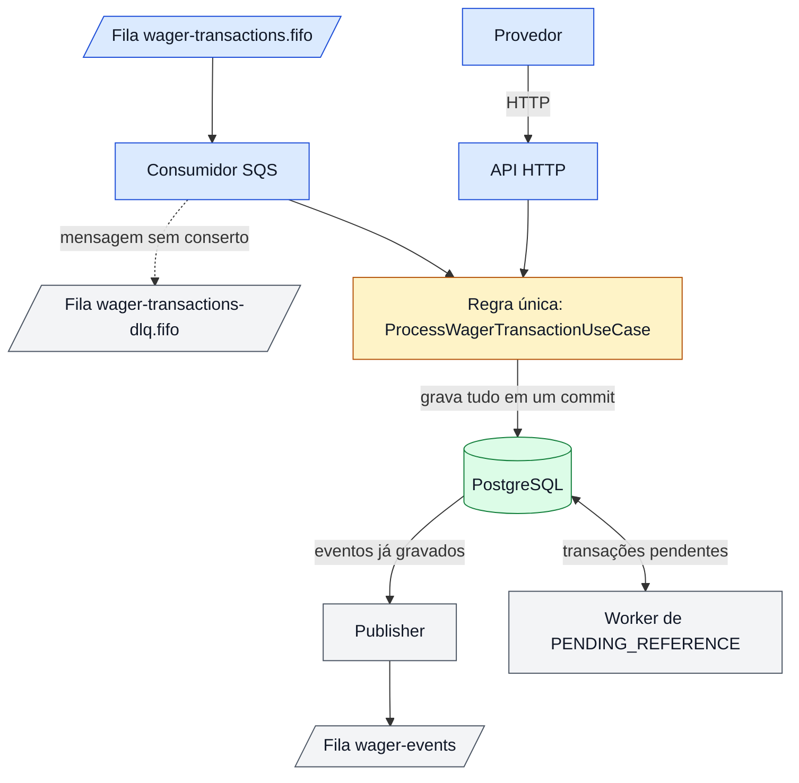
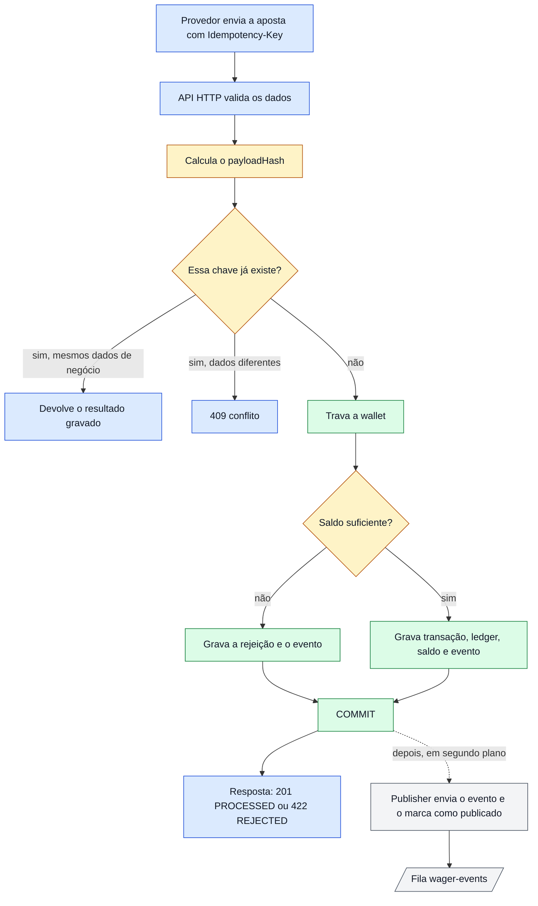
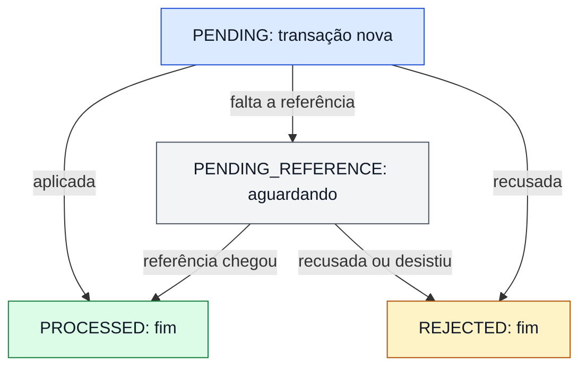

# Distributed Wagering Processor

## O que é

Um serviço que recebe apostas, ganhos e estornos de vários provedores de jogos e mantém correto o saldo de cada carteira (*wallet*), junto com um extrato que nunca é alterado (*ledger*).

O difícil é continuar correto quando as coisas dão errado:

| Situação | O que o serviço faz |
| --- | --- |
| A mesma aposta chega duas vezes | Aplica uma vez e devolve o resultado gravado (idempotência garantida pelo banco) |
| Duas apostas disputam o mesmo saldo | Processa uma por vez em cada wallet (lock no PostgreSQL); o saldo não fica negativo |
| O estorno chega antes da aposta | Guarda como pendente e tenta de novo (`PENDING_REFERENCE`) |
| A aplicação cai logo depois de gravar | O evento já está no banco e é publicado depois (*transactional outbox*) |
| Valores com centavos | Dinheiro nunca é `number`: `bigint` em centavos |

Entradas: API HTTP e fila SQS. Stack: NestJS sob Bun, PostgreSQL e SQS. **Não há autenticação** (ver [Autenticação](#autenticação)).

Decisões, alternativas, trade-offs e limitações: [docs/ARCHITECTURE.md](docs/ARCHITECTURE.md).

**Sumário:** [Início rápido](#início-rápido) · [Comandos](#comandos) · [Como funciona](#como-funciona) · [Exemplos com curl](#exemplos-com-curl) · [Autenticação](#autenticação) · [Mapa de garantias](#mapa-de-garantias) · [Testes e evidências](#testes-e-evidências) · [Limitações](#limitações-conhecidas) · [Solução de problemas](#solução-de-problemas) · [Como este projeto foi desenvolvido](#como-este-projeto-foi-desenvolvido)

## Início rápido

O Docker Compose sobe **apenas a infraestrutura** (PostgreSQL 16 e MiniStack, que emula o SQS). A aplicação roda com Bun na máquina local; **não há Dockerfile da aplicação**.

### Pré-requisitos

| Item | Versão testada | Observação |
| --- | --- | --- |
| [Bun](https://bun.sh) | 1.4.4 | Executa a aplicação, os scripts e os testes |
| Docker com Compose | Docker 29.9.2, Compose v5.6.1 | Precisa estar em execução |
| Git | 2.53.0 | |
| `curl` e um shell bash | curl 8.18.0, bash 5.2.37 | Só para os [exemplos](#exemplos-com-curl); no Windows, use o Git Bash |

Portas que precisam estar livres: **5432** (PostgreSQL), **4566** (MiniStack) e **3000** (aplicação).

### Instalação do zero

```bash
git clone https://github.com/JaoV1ctor/teste-wagering-processor-.git
cd teste-wagering-processor-
bun install
cp .env.example .env
```

O [`.env.example`](.env.example) já vem com os valores do ambiente local do `docker-compose.yml` (credenciais de desenvolvimento): para rodar localmente não é preciso editar nada. Em qualquer outro ambiente, troque-os por segredos reais no `.env`, que é ignorado pelo git e não deve ser versionado.

Depois, nesta ordem:

```bash
docker compose up -d --wait    # sobe os containers e espera ficarem saudáveis (MiniStack: healthcheck da própria imagem)
bun run infra:queues           # espera o MiniStack responder (até 30 s) e cria as três filas
bun run migration:up           # cria o schema
bun run start                  # aplicação em http://localhost:3000 (ocupa o terminal)
```

Em outro terminal, confira:

```bash
curl http://localhost:3000/health/ready
# {"status":"ok","checks":{"postgres":"up","sqs":"up"}}
```

O MiniStack não guarda as filas: **depois de reiniciar os containers, rode `bun run infra:queues` de novo**.

### Variáveis opcionais

Todas têm padrão no código; não precisam estar no `.env`.

<details>
<summary>Ver as variáveis opcionais e os padrões</summary>

| Variável | Padrão | Significado |
| --- | --- | --- |
| `PORT` | `3000` | Porta HTTP |
| `LOCK_TIMEOUT_MS` | `3000` | Prazo de cada espera por lock no PostgreSQL |
| `SQS_CONSUMER_CONCURRENCY` | `5` | Mensagens em processamento ao mesmo tempo no processo |
| `SQS_BATCH_SIZE` | `10` | Máximo por `ReceiveMessage` |
| `SQS_WAIT_TIME_SECONDS` | `20` | Long polling |
| `SQS_VISIBILITY_TIMEOUT_SECONDS` | `30` | Tempo em que a mensagem recebida fica invisível |
| `SQS_RETRY_BASE_SECONDS` | `5` | Base do backoff de falha transitória |
| `SQS_RETRY_MAX_SECONDS` | `120` | Teto do backoff |
| `SHUTDOWN_TIMEOUT_MS` | `25000` | Espera do `SIGTERM` pelas mensagens em andamento |
| `OUTBOX_POLL_INTERVAL_MS` | `1000` | Intervalo do publisher quando o lote não vem cheio |
| `OUTBOX_BATCH_SIZE` | `50` | Eventos reivindicados por passada |
| `OUTBOX_LEASE_MS` | `30000` | Reserva de um evento reivindicado |
| `HEALTH_CHECK_TIMEOUT_MS` | `2000` | Prazo de cada dependência no readiness |

</details>

## Comandos

Todos na raiz do repositório, com os containers no ar e o `.env` copiado do exemplo (o `check` não usa containers). A suíte de integração também exige as filas criadas (`bun run infra:queues`): sem elas, os testes de readiness falham. `test:security` e `test:load` criam os próprios bancos e filas.

| Comando | O que faz | Resultado | Tempo medido |
| --- | --- | --- | --- |
| `bun run check` | Tipos (`tsc --noEmit`), lint e testes de unidade; não usa containers | 514 testes em 37 arquivos, 0 falhas | 8 s |
| `bun run test:integration` | Integração com PostgreSQL e MiniStack reais | 455 testes em 43 arquivos, 0 falhas | 2 min 6 s |
| `bun run test:concurrency` | Paralelismo e processos reais | 32 testes em 9 arquivos, 0 falhas | 50 s |
| `bun run test:security` | Casos de abuso contra a API e a fila; relatório em `security-results/` | 92 casos em 10 arquivos: 78 passaram, 14 confirmam limitações, 0 falharam | 28 s |
| `bun run test:load` | Carga completa (4 cenários) com conferência de invariantes; relatório em `load-results/` | Todas as invariantes passaram | 3 min 16 s |
| `bun run test:load --smoke` | Verificação rápida da carga; os números não servem para análise | Todas as invariantes passaram | 25 s |
| `bun run migration:up` | Aplica as migrations pendentes | 2 migrations em um banco vazio | 1 s |
| `bun run migration:down` | Reverte **uma** migration por execução | 1 migration | 1 s |
| `bun run infra:queues` | Espera o MiniStack responder (até 30 s) e cria as filas (pode ser repetido) | 3 filas | 1 s |
| `bun run start` | Sobe a aplicação | | |

Para rodar uma semente do teste de invariantes aleatórias:

```bash
INVARIANT_SEED=202 INVARIANT_OPS=150 bun test test/concurrency/random-invariants.test.ts   # 2 testes, 10 s
```

### Ambiente em que foi testado

Medido em 2026-11-25, uma execução por comando (os tempos variam entre execuções):

| Item | Valor |
| --- | --- |
| Sistema operacional | Windows 11 Pro (10.0.26300), x64 |
| Máquina | AMD Ryzen 7 5700X (16 processadores lógicos), 32 GB de RAM |
| Docker | Docker Desktop 29.9.2, Compose v5.6.1; VM com 2 CPUs e cerca de 3,8 GB |
| Bun | 1.4.4 |
| Imagens | `postgres:16-alpine` (16.16), `ministackorg/ministack:1.5.44` |

**Linux e macOS não foram verificados.**

## Como funciona

Três desenhos, do geral para o detalhe, lidos de cima para baixo e com as mesmas cores:

| Cor | O que é |
| --- | --- |
| Azul | Entrada e resposta |
| Amarelo | Regra de negócio |
| Verde | Banco, a única fonte de verdade |
| Cinza | Trabalho em segundo plano e destinos |

### 1. O sistema inteiro

Há duas portas de entrada, HTTP e fila, e as duas usam **a mesma regra**. A regra grava tudo no PostgreSQL de uma vez. O que vem depois (publicar eventos e resolver pendências) é feito em segundo plano, a partir do banco.



- O consumidor busca mensagens por *long polling* e só confirma (*ack*) **depois do commit**. Falha transitória volta à fila; falha permanente vai para a DLQ.
- Pode haver várias instâncias da aplicação: quem coordena é o banco, não a memória do processo.

Para operar o serviço:

| Onde | Para que serve |
| --- | --- |
| `POST /wallets/:walletId/reconciliation` | Compara o saldo gravado com a soma do ledger. Só lê, nunca corrige |
| `GET /health/live` | O processo está respondendo? Rota aberta |
| `GET /health/ready` | PostgreSQL e filas de entrada e de eventos estão acessíveis? Rota aberta |
| `GET /metrics` | Métricas no formato Prometheus. Rota aberta |
| Saída padrão (`stdout`) | Logs em JSON, com identificadores e resultado, sem o corpo da requisição |

### 2. Uma aposta, passo a passo

Uma `BET` enviada por HTTP. Os quatro desfechos principais: reenvio, conflito, saldo insuficiente e sucesso.



O que o desenho resume:

| Passo | No código |
| --- | --- |
| API HTTP e regras | Controller HTTP e `ProcessWagerTransactionUseCase` |
| Mesmos dados de negócio | Mesmo `payloadHash`, o SHA-256 desses campos |
| Essa chave já existe? | Busca por `provider_id` e `idempotency_key`, sem lock. Se duas requisições passarem juntas, o `UNIQUE` do banco decide: a segunda vira reenvio ou conflito |
| Trava a wallet | `SELECT ... FOR NO KEY UPDATE`, a primeira instrução da transação SQL que toca a wallet |
| Grava a rejeição ou o sucesso | Tabelas `wager_transactions`, `wallet_ledger_entries`, `wallets` e `outbox_messages`, no mesmo commit |
| Publisher | Reivindica os eventos com `SKIP LOCKED`. Se cair entre publicar e marcar, publica de novo: a entrega é *at-least-once* |

### 3. Os estados de uma transação



Aqui as cores seguem a mesma ideia: azul é a transação que entra, cinza espera o trabalho em segundo plano, verde foi aplicada no banco e amarelo foi barrada por uma regra.

| Estado | Significa | Ainda muda? |
| --- | --- | --- |
| `PENDING` | Acabou de ser criada em memória; nunca é gravada assim | Sim |
| `PENDING_REFERENCE` | Cita uma transação que ainda não chegou (por exemplo, um estorno antes da aposta). O worker tenta de novo | Sim |
| `PROCESSED` | Aplicada | Não |
| `REJECTED` | Recusada por uma regra, com um código de falha | Não |
| `FAILED` | Erro permanente. O domínio permite chegar a ele a partir de `PENDING` e `PENDING_REFERENCE`, mas nenhum caminho atual o usa; por isso não está no desenho | Não |

Estados finais não mudam: além do domínio, o trigger `wager_transactions_guard` recusa a alteração no banco.

## Exemplos com curl

Comandos em bash, executados contra a aplicação local com um banco recém-migrado. As respostas abaixo são as reais, apenas com o JSON quebrado em linhas para leitura; ids e datas serão diferentes na sua execução. Cada resposta HTTP vem seguida do status, impresso pelo `-w`.

### Criar uma wallet

```bash
BASE=http://localhost:3000
PLAYER_ID=3f2b7c1e-8a4d-4b9e-9c21-5d6f0a1b2c3d

curl -s -w '\nHTTP %{http_code}\n' -X POST $BASE/wallets \
  -H 'content-type: application/json' \
  -d '{"playerId":"'$PLAYER_ID'","initialBalance":{"amount":"100.00","currency":"BRL"}}'
```

```
{
  "id": "949a4d2c-dead-453f-b4c3-36fbbac881bf",
  "playerId": "3f2b7c1e-8a4d-4b9e-9c21-5d6f0a1b2c3d",
  "balance": { "amount": "100.00", "currency": "BRL" },
  "version": 1
}
HTTP 201
```

Há uma wallet por player e moeda: para repetir o roteiro no mesmo banco, troque o `PLAYER_ID`.

### BET com Idempotency-Key

```bash
WALLET_ID=949a4d2c-dead-453f-b4c3-36fbbac881bf   # use o "id" da sua resposta

BET='{"providerId":"provider-a","externalTransactionId":"bet-001","playerId":"'$PLAYER_ID'","walletId":"'$WALLET_ID'","roundId":"round-1","gameId":"game-1","kind":"BET","money":{"amount":"25.00","currency":"BRL"}}'
bet() { curl -s -w '\nHTTP %{http_code}\n' -X POST $BASE/wagering/transactions -H 'content-type: application/json' -H 'Idempotency-Key: provider-a:bet-001' -d "$1"; }

bet "$BET"
```

```
{
  "transactionId": "be935f1f-15ad-4d95-82d4-65734d8d10b5",
  "status": "PROCESSED",
  "balance": { "amount": "75.00", "currency": "BRL" },
  "idempotentReplay": false
}
HTTP 201
```

### Reenvio (replay) e conflito

O mesmo corpo com a mesma chave devolve o resultado gravado, sem debitar de novo:

```bash
bet "$BET"
```

```
{
  "transactionId": "be935f1f-15ad-4d95-82d4-65734d8d10b5",
  "status": "PROCESSED",
  "balance": { "amount": "75.00", "currency": "BRL" },
  "idempotentReplay": true
}
HTTP 201
```

A mesma chave com outro valor é conflito:

```bash
bet "${BET/25.00/30.00}"
```

```
{
  "code": "IDEMPOTENCY_CONFLICT",
  "message": "Conflito de idempotência: a chave ou a identidade do provedor já pertence a outro payload"
}
HTTP 409
```

### Consultar a transação

```bash
TX_ID=be935f1f-15ad-4d95-82d4-65734d8d10b5   # use o "transactionId" da sua resposta

curl -s -w '\nHTTP %{http_code}\n' $BASE/wagering/transactions/$TX_ID
```

<details>
<summary>Ver a resposta (HTTP 200)</summary>

```
{
  "transactionId": "be935f1f-15ad-4d95-82d4-65734d8d10b5",
  "providerId": "provider-a",
  "externalTransactionId": "bet-001",
  "walletId": "949a4d2c-dead-453f-b4c3-36fbbac881bf",
  "playerId": "3f2b7c1e-8a4d-4b9e-9c21-5d6f0a1b2c3d",
  "roundId": "round-1",
  "gameId": "game-1",
  "kind": "BET",
  "money": { "amount": "25.00", "currency": "BRL" },
  "status": "PROCESSED",
  "failureCode": null,
  "balance": { "amount": "75.00", "currency": "BRL" },
  "createdAt": "2026-11-25T18:54:35.024Z",
  "processedAt": "2026-11-25T18:54:35.024Z"
}
HTTP 200
```

</details>

Também pela identidade no provedor:

```bash
curl -s -w '\nHTTP %{http_code}\n' $BASE/providers/provider-a/wagering/transactions/bet-001
```

A resposta é idêntica à anterior, também com `HTTP 200`.

### Ledger

O primeiro lançamento é o crédito de abertura da wallet. A paginação usa `limit` e `cursor` (o `nextCursor` da página anterior).

```bash
curl -s -w '\nHTTP %{http_code}\n' "$BASE/wallets/$WALLET_ID/ledger?limit=10"
```

<details>
<summary>Ver a resposta (HTTP 200)</summary>

```
{
  "items": [
    {
      "id": "3f3adf0b-907b-44ae-816e-c72e7f4f6f54",
      "transactionId": "27d21faf-2b62-43df-b1aa-bce362445137",
      "direction": "CREDIT",
      "money": { "amount": "100.00", "currency": "BRL" },
      "balanceBefore": { "amount": "0.00", "currency": "BRL" },
      "balanceAfter": { "amount": "100.00", "currency": "BRL" },
      "createdAt": "2026-11-25T18:54:34.481Z"
    },
    {
      "id": "42dd2c0e-176e-40fe-a588-0853437be2eb",
      "transactionId": "be935f1f-15ad-4d95-82d4-65734d8d10b5",
      "direction": "DEBIT",
      "money": { "amount": "25.00", "currency": "BRL" },
      "balanceBefore": { "amount": "100.00", "currency": "BRL" },
      "balanceAfter": { "amount": "75.00", "currency": "BRL" },
      "createdAt": "2026-11-25T18:54:35.024Z"
    }
  ],
  "nextCursor": null
}
HTTP 200
```

</details>

### Reconciliação

```bash
curl -s -w '\nHTTP %{http_code}\n' -X POST $BASE/wallets/$WALLET_ID/reconciliation
```

```
{
  "walletId": "949a4d2c-dead-453f-b4c3-36fbbac881bf",
  "storedBalance": { "amount": "75.00", "currency": "BRL" },
  "calculatedBalance": { "amount": "75.00", "currency": "BRL" },
  "difference": { "amount": "0.00", "currency": "BRL" },
  "consistent": true,
  "checkedEntries": 2
}
HTTP 200
```

### Health

```bash
curl -s -w '\nHTTP %{http_code}\n' $BASE/health/live
curl -s -w '\nHTTP %{http_code}\n' $BASE/health/ready
```

```
{ "status": "ok" }
HTTP 200
{
  "status": "ok",
  "checks": { "postgres": "up", "sqs": "up" }
}
HTTP 200
```

### Enviar pela fila SQS

Um `WIN` que referencia a `BET`, publicado em `wager-transactions.fifo`. Sem `--message-id` e `--idempotency-key`, o script gera o `messageId` e usa `{providerId}:{externalTransactionId}` como chave.

```bash
bun run scripts/send-wager-message.ts --wallet-id $WALLET_ID --player-id $PLAYER_ID --provider-id provider-a \
  --external-transaction-id win-001 --round-id round-1 --game-id game-1 --kind WIN --amount 40.00 --currency BRL --reference bet-001
```

```
{
  "messageId": "c383e2f7-d984-4a40-a052-780e2643c966",
  "externalTransactionId": "win-001"
}
```

O processamento é assíncrono; alguns segundos depois:

```bash
curl -s -w '\nHTTP %{http_code}\n' $BASE/providers/provider-a/wagering/transactions/win-001
curl -s -w '\nHTTP %{http_code}\n' $BASE/wallets/$WALLET_ID
```

<details>
<summary>Ver as respostas: a transação e a wallet (HTTP 200)</summary>

```
{
  "transactionId": "d1a99407-d56b-4367-a512-5ad1981ac858",
  "providerId": "provider-a",
  "externalTransactionId": "win-001",
  "walletId": "949a4d2c-dead-453f-b4c3-36fbbac881bf",
  "playerId": "3f2b7c1e-8a4d-4b9e-9c21-5d6f0a1b2c3d",
  "roundId": "round-1",
  "gameId": "game-1",
  "kind": "WIN",
  "money": { "amount": "40.00", "currency": "BRL" },
  "status": "PROCESSED",
  "failureCode": null,
  "balance": { "amount": "115.00", "currency": "BRL" },
  "createdAt": "2026-11-25T18:54:36.458Z",
  "processedAt": "2026-11-25T18:54:36.458Z"
}
HTTP 200
{
  "id": "949a4d2c-dead-453f-b4c3-36fbbac881bf",
  "playerId": "3f2b7c1e-8a4d-4b9e-9c21-5d6f0a1b2c3d",
  "balance": { "amount": "115.00", "currency": "BRL" },
  "version": 3
}
HTTP 200
```

</details>

### Métricas

Formato texto do Prometheus. O filtro abaixo omite os comentários e os buckets dos histogramas:

```bash
curl -s $BASE/metrics | grep -E '^(wager_|outbox_)' | grep -v _bucket
```

<details>
<summary>Ver a resposta</summary>

```
wager_transactions_total{status="PROCESSED",kind="BET"} 1
wager_transactions_total{status="PROCESSED",kind="WIN"} 1
wager_duplicates_total 1
wager_dlq_messages_total 0
wager_lock_conflicts_total 0
wager_wallet_lock_wait_seconds_sum 0.001492899999999736
wager_wallet_lock_wait_seconds_count 2
wager_processing_duration_seconds_sum 0.05496469999999999
wager_processing_duration_seconds_count 3
wager_reconciliation_divergence_total 0
wager_outbox_lag_seconds 0
```

</details>

## Autenticação

`/health/live`, `/health/ready` e `/metrics` são rotas abertas. As demais passam por um guard global que **hoje é no-op**: nada é autenticado nem autorizado, e quem alcança a porta HTTP (ou publica na fila de entrada) opera como qualquer provedor. O serviço não deve ser exposto fora de uma rede confiável. A decisão, o desenho que seria adotado e o ponto de extensão no código estão em [Autenticação](docs/ARCHITECTURE.md#autenticação), no documento de arquitetura.

## Mapa de garantias

Cada garantia e a seção de [docs/ARCHITECTURE.md](docs/ARCHITECTURE.md) que a explica.

| Garantia | Seção |
| --- | --- |
| Visão de todas as garantias, com o mecanismo e o teste que prova cada uma | [Garantias e como são provadas](docs/ARCHITECTURE.md#garantias-e-como-são-provadas) |
| Dinheiro nunca passa por ponto flutuante | [Mapeamento do Money](docs/ARCHITECTURE.md#mapeamento-do-money) |
| Saldo correto sob concorrência: lock por wallet e ordem global de locks | [Estratégia transacional e de locks](docs/ARCHITECTURE.md#estratégia-transacional-e-de-locks) |
| Idempotência no banco: replay e conflito separados pelo `payloadHash` | [Idempotência e payloadHash](docs/ARCHITECTURE.md#idempotência-e-payloadhash) |
| Estados terminais não mudam | [Máquina de estados de WagerTransaction](docs/ARCHITECTURE.md#máquina-de-estados-de-wagertransaction) |
| Rejeições auditáveis, com código estável | [Códigos de falha](docs/ARCHITECTURE.md#códigos-de-falha) |
| Referência que chega depois, com limite de espera | [Limite do PENDING_REFERENCE](docs/ARCHITECTURE.md#limite-do-pending_reference) |
| Mensagem repetida não reprocessa | [Inbox e idempotência são camadas diferentes](docs/ARCHITECTURE.md#inbox-e-idempotência-são-camadas-diferentes) |
| Falha transitória volta à fila; permanente vai à DLQ | [Classificação de erros](docs/ARCHITECTURE.md#classificação-de-erros) |
| Entrega dos eventos: at-least-once, sem ordem | [O que é e o que não é garantido ao consumidor dos eventos](docs/ARCHITECTURE.md#o-que-é-e-o-que-não-é-garantido-ao-consumidor-dos-eventos) |
| Divergência entre saldo e ledger é reportada, nunca corrigida | [Reconciliação](docs/ARCHITECTURE.md#reconciliação-post-walletswalletidreconciliation) |

## Testes e evidências

Os testes de integração, concorrência, segurança e carga usam PostgreSQL e MiniStack reais, sem mock de nenhum dos dois.

| Suíte | O que prova | Números |
| --- | --- | --- |
| Unidade (`bun run check`) | `Money`, invariantes da `Wallet`, regras de cada tipo de transação, `payloadHash`, classificação de erros; uma regra de lint proíbe `number` para dinheiro | 514 testes, 0 falhas |
| Integração (`bun run test:integration`) | Migrations, constraints e triggers, atomicidade entre wallet, ledger, inbox e outbox, inbox, retry, DLQ e recuperação | 455 testes, 0 falhas |
| Concorrência (`bun run test:concurrency`) | A mesma `BET` 50 vezes em paralelo gera 1 débito; 30 apostas de 10,00 sobre saldo 100,00 processam exatamente 10; 3 processos simultâneos; processo morto entre o commit e o ack | 32 testes, 0 falhas |
| Invariantes aleatórias (dentro da suíte de concorrência) | Sequências geradas por semente (`101`, `202` e `303`, 150 operações em cada execução, sequencial e concorrente), comparadas com um modelo de referência e com consultas sobre o banco inteiro. Na falha, o teste imprime a semente e reduz a sequência | Ver [Invariantes sob operações aleatórias](docs/ARCHITECTURE.md#invariantes-sob-operações-aleatórias) |
| Segurança (`bun run test:security`) | Injeção, abuso de valores e de protocolo, idempotência entre provedores, gasto duplo, vazamento, mensagens venenosas, disponibilidade e segredos. Não é um pentest | 92 casos: 78 passaram, 14 confirmam limitações, 0 falharam |
| Carga (`bun run test:load`) | Latência, vazão e atraso do outbox em uma máquina, com invariantes conferidas ao fim de cada cenário. Não mede capacidade de produção | 535,38 req/s com 100 wallets contra 123,59 req/s em uma única wallet (p50 de 58,59 contra 256,88 ms); invariantes passaram em todos os cenários |

Detalhes:

- [Cobertura dos testes obrigatórios](docs/ARCHITECTURE.md#cobertura-dos-testes-obrigatórios): cada item e o arquivo e teste que o prova.
- [docs/LOAD_TEST.md](docs/LOAD_TEST.md): metodologia, resultados, análise e limitações da carga.
- [docs/SECURITY_TESTS.md](docs/SECURITY_TESTS.md): casos, achados e o que não foi coberto.

## Estrutura de pastas

<details>
<summary>Ver a árvore de pastas</summary>

```
.
├── src/
│   ├── domain/              # TypeScript puro: Money, Wallet, WagerTransaction, ledger, regras e eventos
│   ├── application/         # casos de uso, portas e payloadHash
│   ├── infrastructure/
│   │   ├── persistence/     # entidades MikroORM, mappers, repositórios e unit of work
│   │   ├── messaging/       # cliente e adaptadores SQS, configuração do consumidor e do publisher
│   │   ├── workers/         # laço de fundo dos workers
│   │   ├── observability/   # métricas e logs JSON
│   │   ├── health/          # verificações de readiness
│   │   └── identity/        # adaptador da identidade do provedor (hoje confia no corpo)
│   ├── interface/
│   │   ├── http/            # controllers, DTOs, guards e mapeamento de erros
│   │   └── sqs/             # consumidor e tradução das mensagens
│   ├── app.module.ts        # composição
│   └── main.ts              # sobe o HTTP, o consumidor, o worker e o publisher
├── db/                      # SQL das migrations (up e down) e as classes em db/migrations/
├── scripts/                 # filas, migrations, envio de mensagem, carga e segurança
├── test/
│   ├── unit/
│   ├── integration/
│   ├── concurrency/
│   ├── security/
│   └── support/             # apoio dos testes, inclusive o gerador de invariantes aleatórias
├── docs/                    # arquitetura, teste de carga e testes de segurança
├── docker-compose.yml       # PostgreSQL e MiniStack
└── .env.example
```

</details>

## Limitações conhecidas

A lista completa, com justificativas e trade-offs, está em [Limitações conhecidas](docs/ARCHITECTURE.md#limitações-conhecidas).

1. **Sem autenticação nem autorização**, e sem rate limiting; `/metrics` e health são abertos.
2. **Wallet quente:** escritas na mesma wallet são serializadas. O `lock_timeout` limita cada espera por lock, não a espera total na fila, e não há `statement_timeout`.
3. **Pool de conexões:** requisições suficientes contra uma wallet travada ocupam as conexões da instância, atrasam as outras wallets e fazem `/health/ready` responder `503`.
4. **Eventos:** entrega at-least-once e sem ordem (o consumidor deduplica por `eventId` e ordena o saldo por `walletVersion`); no teste de carga, o publisher publicou mais devagar do que os eventos eram gravados.
5. **Fila de entrada:** não é autenticada, e o inbox deduplica por `(consumidor, messageId)`, não por provedor: os produtores precisam de ids únicos entre si.
6. **MiniStack não é o SQS da AWS:** o comportamento de FIFO, DLQ, latência e cotas não foi verificado na AWS.
7. **Reversões:** não há reversão parcial; uma referência que não chega dentro do limite de tentativas vira `REJECTED`.
8. **Execução:** não há Dockerfile da aplicação, e o projeto só foi executado em Windows 11.

## Solução de problemas

### `/health/ready` responde 503 com `"sqs":"down"` depois de reiniciar os containers

O MiniStack perde as filas ao reiniciar. A aplicação registra `"errorName":"QueueDoesNotExist"` no log. Recrie-as; não é preciso reiniciar a aplicação:

```bash
bun run infra:queues
```

Os testes de integração também falham no readiness enquanto as filas não existirem.

### Porta em uso

Com a porta 3000 ocupada, a aplicação encerra com `"Failed to start server. Is port 3000 in use?"` e `"errorCode":"EADDRINUSE"`. Encerre o outro processo ou use outra porta (e ajuste a URL dos exemplos):

```bash
PORT=3001 bun run start
```

As portas 5432 e 4566 são fixas no `docker-compose.yml`: se um PostgreSQL local ou os containers de outra cópia do projeto as estiverem usando, pare-os antes do `docker compose up`.

### Migration já aplicada

Rodar `bun run migration:up` de novo é seguro e não altera nada:

```
up: 0 migration(s) executada(s)
```

### `migration:down` recusa a reversão

A reversão que devolve a unicidade global da `Idempotency-Key` só é possível enquanto nenhuma chave tiver sido usada por mais de um provedor. Depois disso, ela falha e nada muda, porque transações não se apagam nem se reescrevem:

```
UniqueConstraintViolationException: 002 down: 1 idempotency_key(s) usada(s) por mais de um provedor; a unicidade global não pode ser restaurada
```

Em um ambiente descartável, a saída é recriar o banco.

## Como este projeto foi desenvolvido

Este projeto foi desenvolvido pelo autor, que definiu o escopo, tomou as decisões de arquitetura, validou cada etapa e conduziu as revisões. Para isso usou ferramentas de IA: Claude (Anthropic) como apoio ao planejamento, à especificação e à revisão; Claude Code para escrever o código a partir das especificações e critérios de aceite do autor; e Codex (OpenAI) para uma revisão independente, em modo somente leitura. Cada etapa só entrou depois de passar por `bun run check` e pelas suítes de integração e concorrência, e os problemas achados na revisão foram reproduzidos com teste e corrigidos. O autor responde pelas decisões e pelo resultado.
